# UX walkthrough, 2026-10-19

Peter's narrated screen recording from 2026-10-19, walking through what feels clunky in the UI, mostly the Scene panel and the 3D scene card. The source video is `/Users/peterkiemann/Desktop/Screen Recording 2026-10-19 at 3.46.09 pm.mov` (not committed; the space before `pm` is a non-breaking space), and `transcript.srt` / `transcript.txt` are the raw whisper output.

Timestamps are minutes:seconds into the video. Frames are in `frames/`, named by the moment they show. The recording captures only the main window, so anything inside the separate graph editor window has no frames.

## Scene card (Layer tab)

**0:47 to 1:14. The card for 3D scenes.** "the card for 3d scenes is a bit clunky… it's not fantastic."
The Layer tab shows the "Physics Boxes" card with drawers Camera (Orbit, Tilt, Distance, Target Height, Field of View, Focus Distance), Physics (Box Count, Reset), Lighting (Exposure, Environment, Sun) and Look (Depth of Field, Motion Blur). Focus Distance is a live slider while the grey note under it says "Depth of field is off", and the Depth of Field switch that turns it on sits three drawers lower. Reset is a ▶ button with only an A button beside it, where every other row has T, wave and A. Sun has a small white square in front of its slider and no unit.
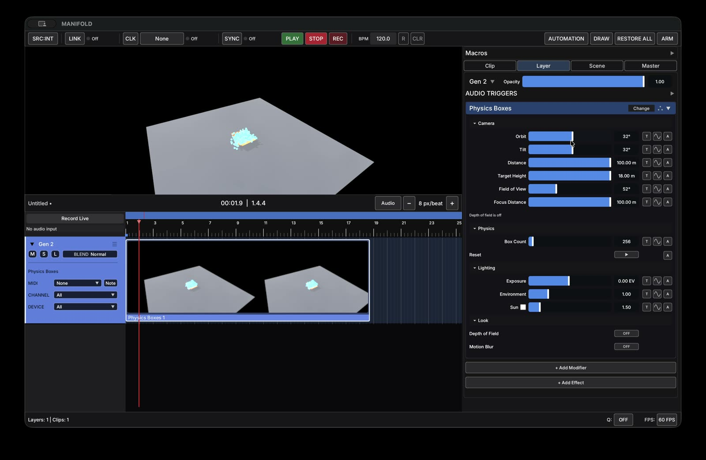

**1:49 to 2:03. Dev scenes in the app.** "we have all these weird custom like dev scenes almost that make it into the app"
He says this from inside the Physics Boxes scene. The generator browser (frame from 0:35) lists six water entries named after the engine or test setup: "Water — Dam Break (GPU FLIP)", "(Live GPU)", "(Particle View)", "Water — Floating Box (Live GPU)", "Water — Sea Wall (GPU FLIP)", "Water — Still Pool (Live GPU)".
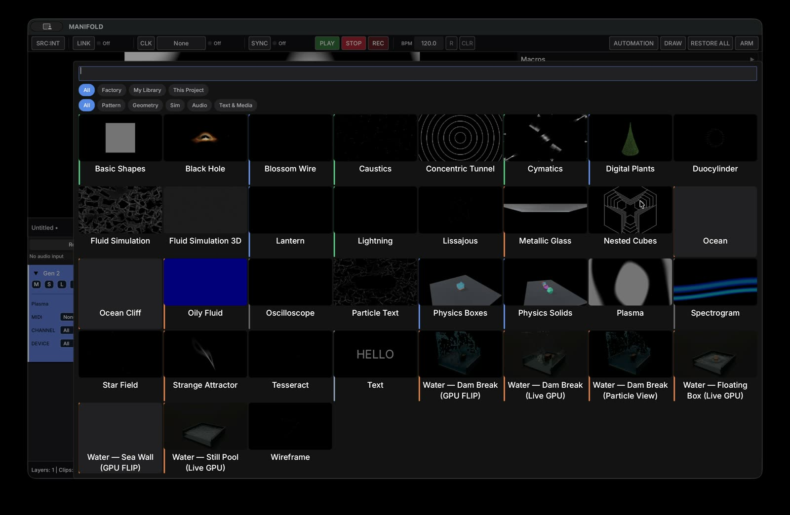

**5:22 to 5:49. Mapping lives in the graph editor; slider range is hidden in a menu.** "it would be nice to have access to this without opening the graph editor… it'd be nice to have the like mapping panel here instead of this… i did not even know this existed this is crazy"
Right-clicking the Orbit label on the card opens: Remove from Card, Show in Scene tab, Set slider range…, Reset slider range, Show Automation, Clear Automation, Map to Macro 1 to 8, and a greyed "Ableton not connected". "Set slider range…" drops a small text field reading "-360 to 360" on top of the Orbit label. The mapping panel he likes is in the graph editor, which this recording does not show.
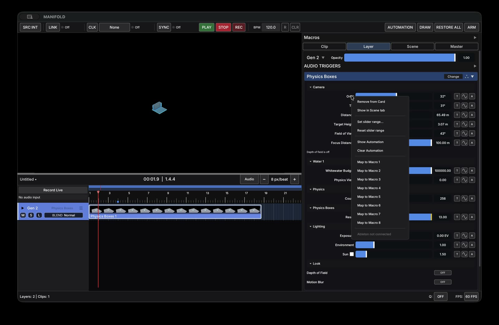
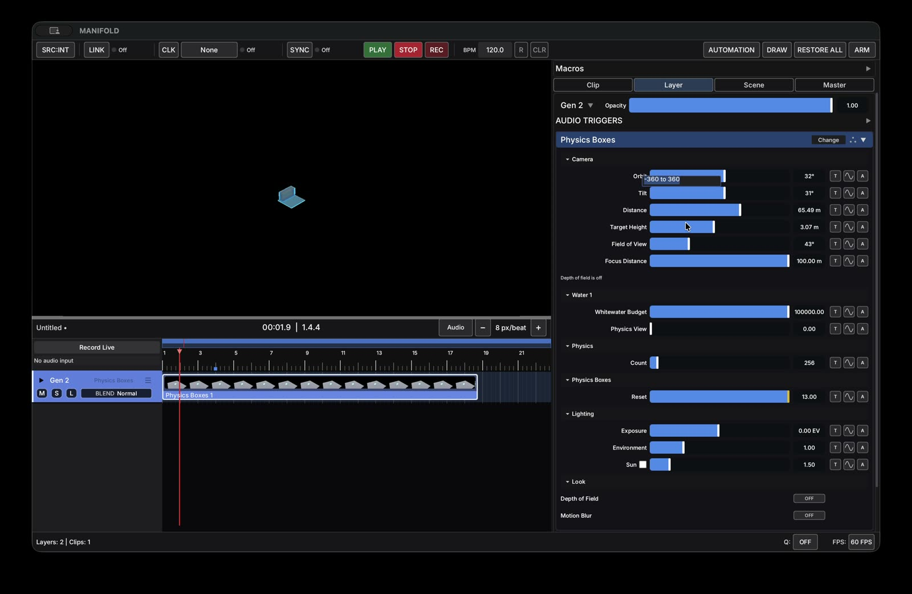

**10:26 to 10:41. A card heading that is secretly a link.** "i don't know what i just did… i clicked physics see i didn't even know i could do that"
On the card, "▾ Physics" looks like every other drawer heading. Clicking it switches to the Scene tab with the Physics node selected.
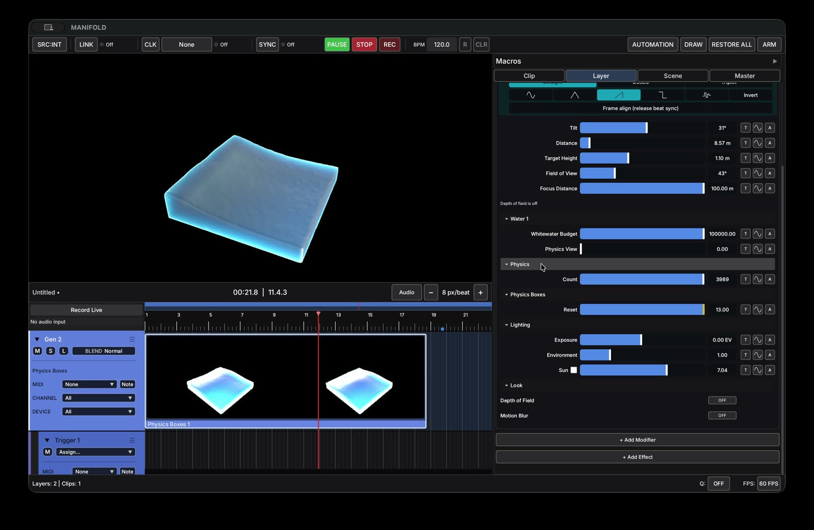
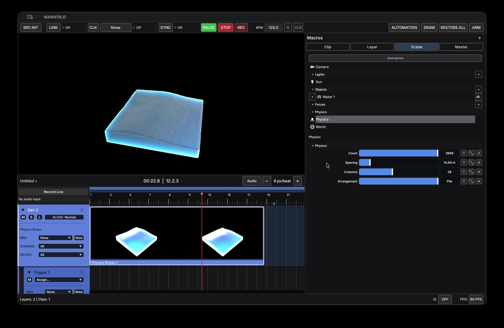

## Scene panel and materials

**1:03 to 1:23. The Scene tab.** "when I go to the scene it's just a bit clunky… it's hard to explain"
The Scene tab stacks a Show gizmos bar, the tree (Camera; Lights > Sun; Objects > Ground, Boxes, Left Ramp, Right Ramp; Forces, empty; Physics > Physics; World) and the selected object's settings (Ground: Object, Frame, copy and × buttons, Transform, Billboard, Material) in one scroll. As soon as he scrolls into an object's settings the tree is gone (see the material frames below), and between 1:10 and 3:45 he scrolls up and down repeatedly to get back to it.
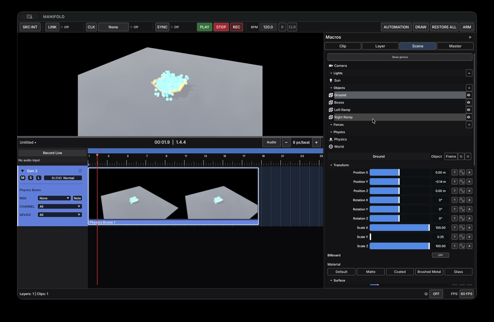

**1:23 to 1:30. Materials.** "the materials is really ugly like hard to use"
Material is a row of five preset buttons (Default, Matte, Coated, Brushed Metal, Glass). Below: Surface with Base Colour as three separate R, G, B sliders, Metallic, Roughness; Opacity & Cutout with Alpha Mode as a slider reading "Solid"; a collapsed "Advanced" with "(186)" at the far right; Optional Features as eight "+ Add …" buttons in a grid; Textures > Skin with "Source: None" and "Map: Emissive". The preset buttons and the "+ Add" buttons look the same. "Glass" is both a preset and "+ Add Glass".
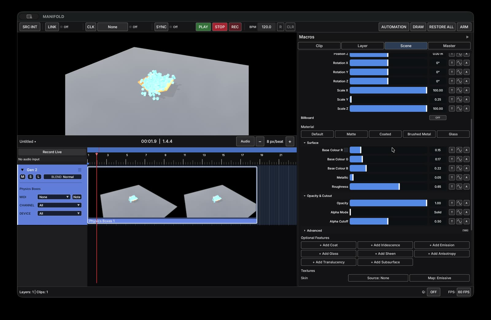

**1:28. Adding iridescence.** "if I add iridescence okay it's here and I can remove it"
An "Iridescence" drawer appears with its own × at the right, a full-width "Enabled: On" button, and four sliders (Iridescence, Iridescence IOR, Thickness Min 100 nm, Thickness Max 400 nm). The whole ground plane turns pink in the preview. The "+ Add" grid reflows because one button left it. The Density value below is cut off ("00.00 kg/n").
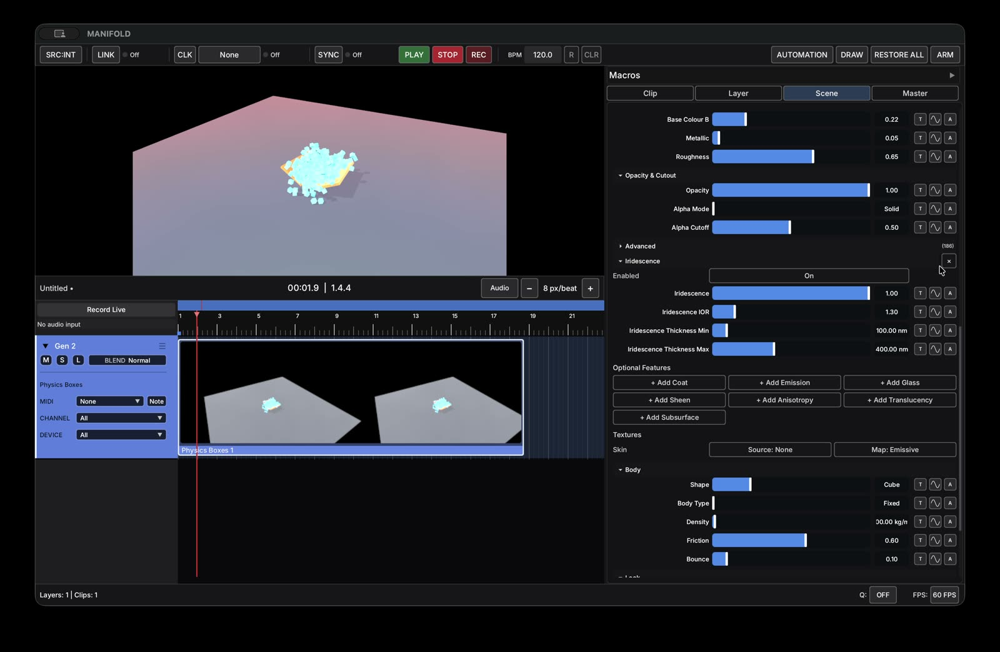

**1:34 to 1:45. Glass and its "Enabled" switch.** "if I add glass… but I have this like enabled thing… it's just not fantastic"
The Glass drawer has a × to remove it and a separate "Enabled" button (he clicks it to Off), then thirteen raw sliders: Index of Refraction, Dispersion, Transmission, Volume Thickness, Volume Attenuation Distance (value cut off as "000000.0("), Volume Attenuation Colour R/G/B (label cut off as "/olume Attenuation Colour R"), Geometric Volume, Volume Scattering Density, Volume Scattering Colour R/G/B, Volume Particle Density. Adding, enabling and removing are three different controls.
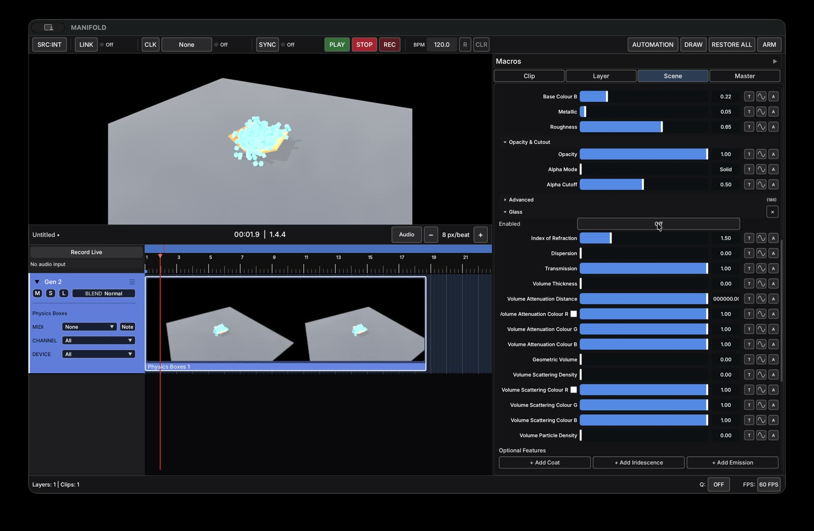

**1:49 to 2:22. Physics boxes settings live in odd places.** "all of the stuff about the physics boxes in here is under the physics scene so it's like is this for general scenes or what… spacing columns… if I wanted to add a bunch of boxes with physics in a normal scene how would that work"
The Boxes object has Body (Shape, Body Type, Density, Friction, Bounce) and a "Physics" drawer holding Box Count, Reset, Gravity X/Y/Z, Speed, Spacing, Columns and Arrangement. Spawner, world gravity and per-object settings share one object. After he removes every object and adds water, the Scene tab's Physics node still holds Count, Spacing, Columns and Arrangement (frame above, 10:25), and the card still says "Physics Boxes" with Physics > Count and Physics Boxes > Reset (5:41 frame).
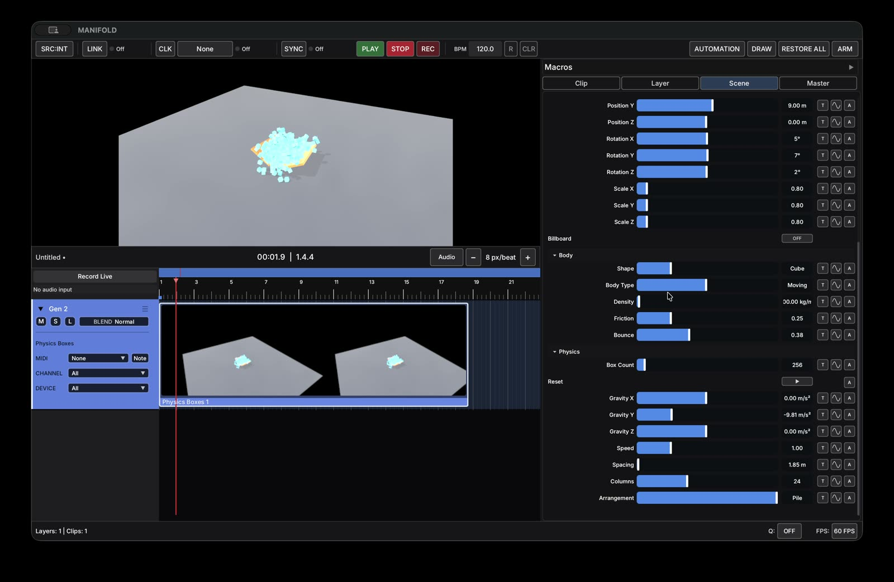

**3:09 to 3:27. Colour entry.** "the base color thing i can no longer type a hex directly and it's now on just the r like that's weird to me"
The colour swatch sits on the Base Colour R row only. Clicking it opens a palette grid with "Hex…" as the first item. The G and B rows have no swatch.
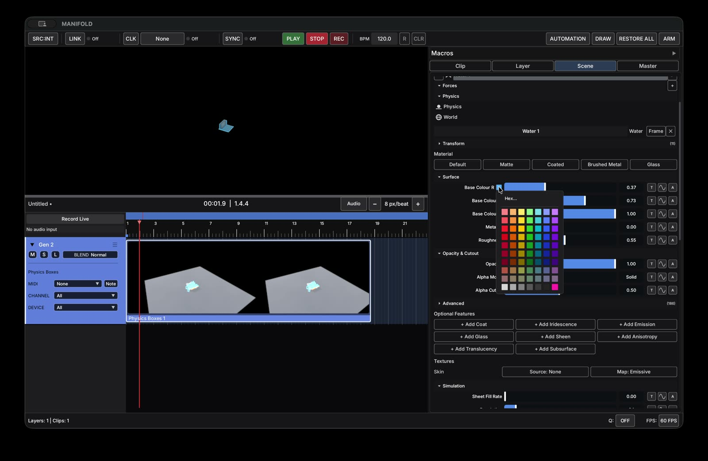

**3:34 to 3:49. Drawers versus things you click.** "it's a bit hard to tell between like a [drawer] and like a thing that you're going to click on i sometimes just close things by accident"
In the tree, group headings (▾ Lights, ▾ Objects, ▾ Forces, ▾ Physics) and items (Sun, Water 1, Physics, World) have the same row height and the same hover highlight. The group "Physics" holds an item also called "Physics". The object header under the tree puts × right next to Frame. No accidental close happens on camera here; he is hovering the tree when he says it.
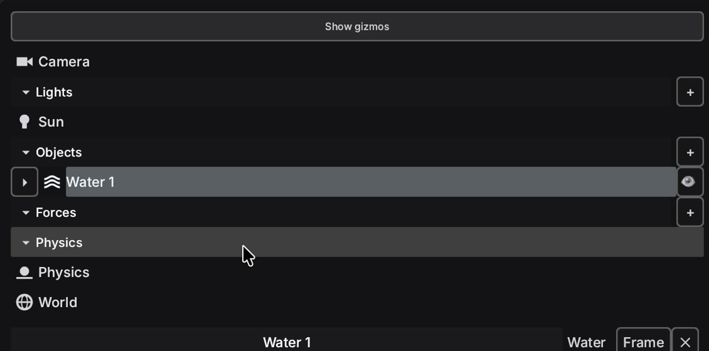

## Lights and world

**5:49 to 6:16. Modulation shows up somewhere else, then vanishes.** "if i automate this stuff i think it gets added which is okay but now now it's gone so it's kind of confusing"
In the Scene tab he turns on the wave (LFO) button on the Sun's Intensity and its drawer opens (1/32 to Free, Straight/Dotted/Triplet, wave shapes, Invert, Frame align). On the card, Lighting > Sun shows the same drawer and the same 5.00: the card's "Sun" is the Sun light's Intensity under another name. At 6:07 he clicks the wave button again in the Scene tab and the drawer closes in both places.
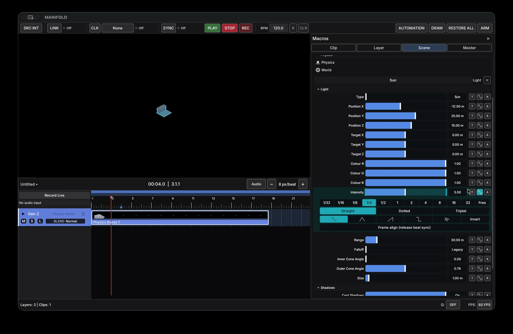
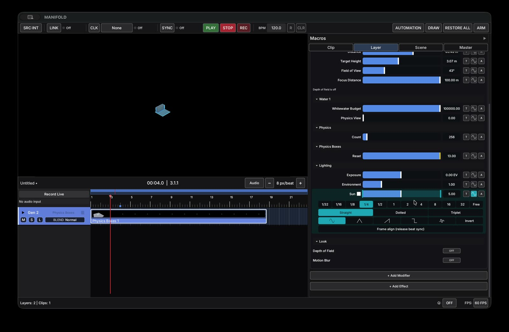

**6:16 to 6:27. Lights and camera.** "the lights like i don't know what this is doing now like why… why does my camera"
The Camera node: a "Use this view" button, Orbit, Tilt, Distance 65.49 m, Field of View, Target Height, Roll, Near Clip, Far Clip, Lens > Exposure, then Depth of Field settings (Focus Distance, F-Stop 32, Max Blur 24 px) above the "Depth of Field: OFF" switch that controls them. At 65 m the water is a small shape in the middle of the preview. Orbit, Tilt, Distance, Target Height, Field of View and Focus Distance are also on the card, and Exposure is also on the card under Lighting.
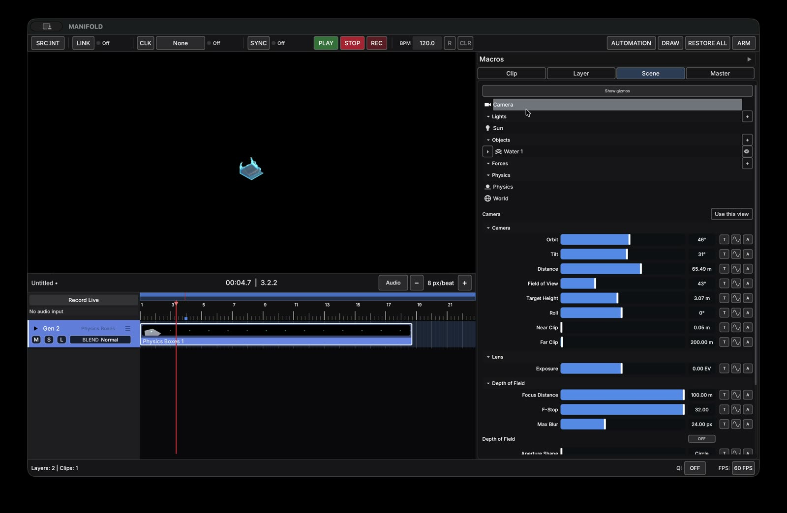

**6:39 to 7:06. The Sun light.** "intensity it doesn't seem to be really doing oh no it's doing a bit… intensity range fall off legacy inverse square i didn't know this was a thing… they're just dumped on the user… shadow bias like what is this stuff"
The Sun shows Type (a slider reading "Sun"), Position X/Y/Z, Target X/Y/Z, Colour R/G/B, Intensity, Range 30 m, Falloff (value cut off as "/erse Squa"), Inner Cone Angle, Outer Cone Angle and Size. Range, Falloff and the cone angles are settings for other light types, shown on a sun. At 6:45 Intensity is up at 9.71 and the water still looks grey. Shadows has Cast Shadows (a slider reading "On"), Shadow Softness, Shadow Bias and Shadow Resolution 2048, with no hint for any of them.
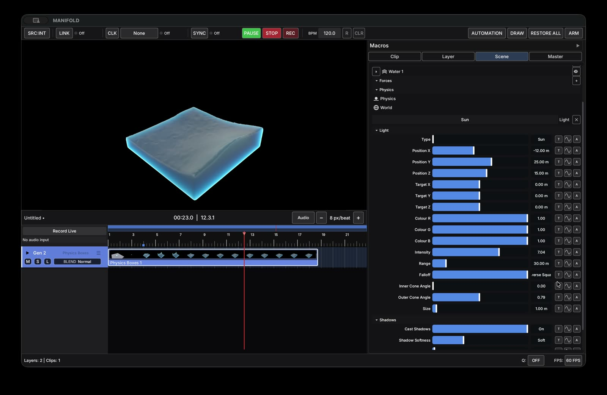
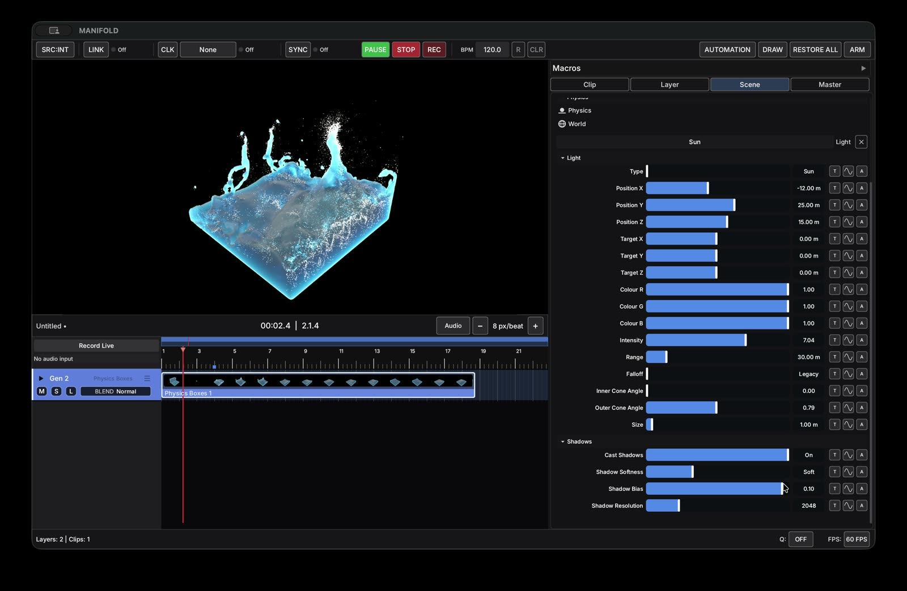

**7:08 to 7:40. Environment.** "where is my environment stuff now like… i have to go to world and now there's like all this horizon strength stuff… softbox gradient like what is that"
The card has one "Environment" slider. The real settings are in the Scene tab under World > Environment: Width 512, Height 256, Horizon Strength, Brightness Variation, Intensity, Mode (a slider reading "Softbox"), Emitter Count, Emitter Intensity, Emitter Elevation, Emitter Width, Sun X/Y/Z, Sun Disc Intensity, Sun Disc Size, Fill Light, then a Ray Tracing drawer. Mode has two values, Softbox and Gradient, picked by dragging a slider end to end.
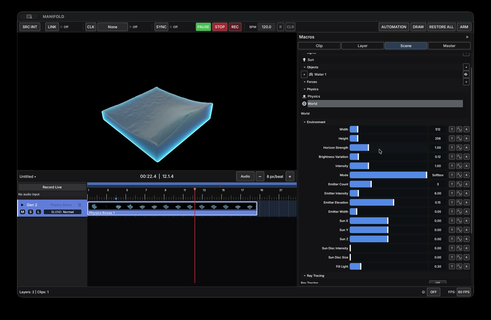
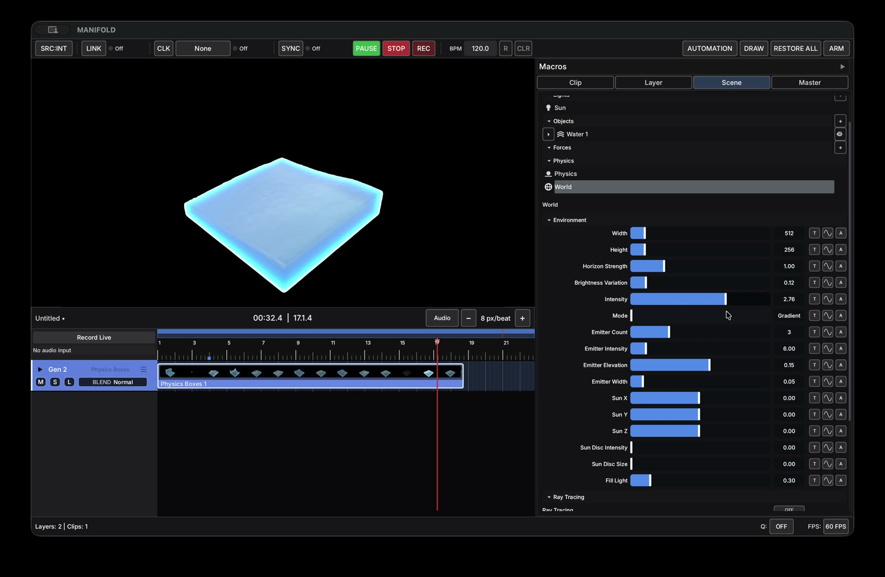

**7:41 to 8:08. Emitters and a second sun.** "[emitter count] like what is [emitter count]… emitter intensity like what's emitter intensity… sun is here again like what's going on sun disc intensity"
Emitter Count at 8 with Intensity 3.04 blows the water out to flat white. World carries its own Sun X/Y/Z, Sun Disc Intensity and Sun Disc Size, separate from Lights > Sun and from the card's Lighting > Sun.
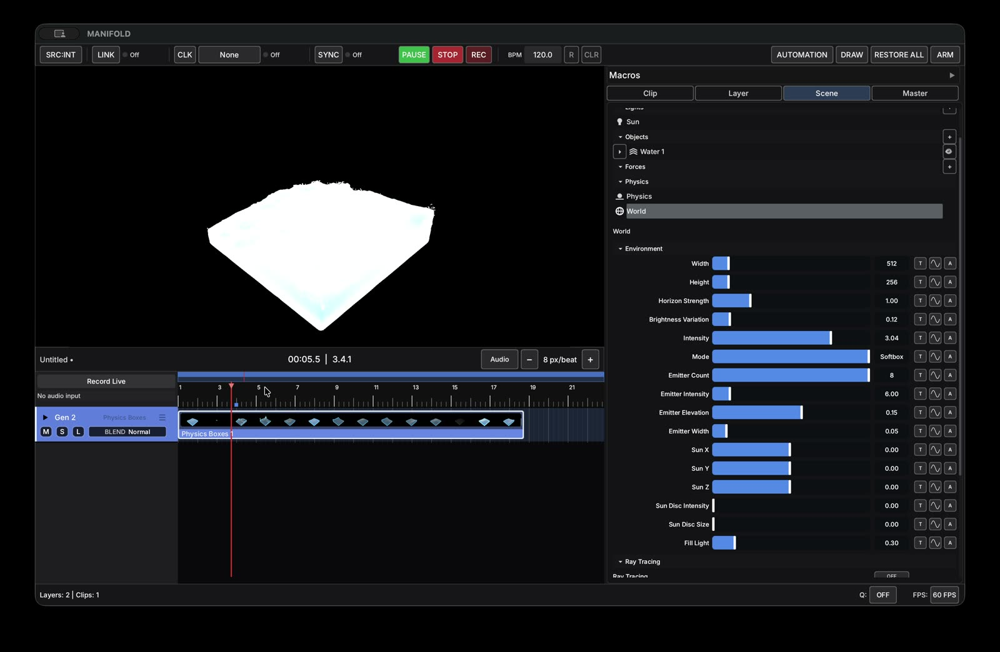
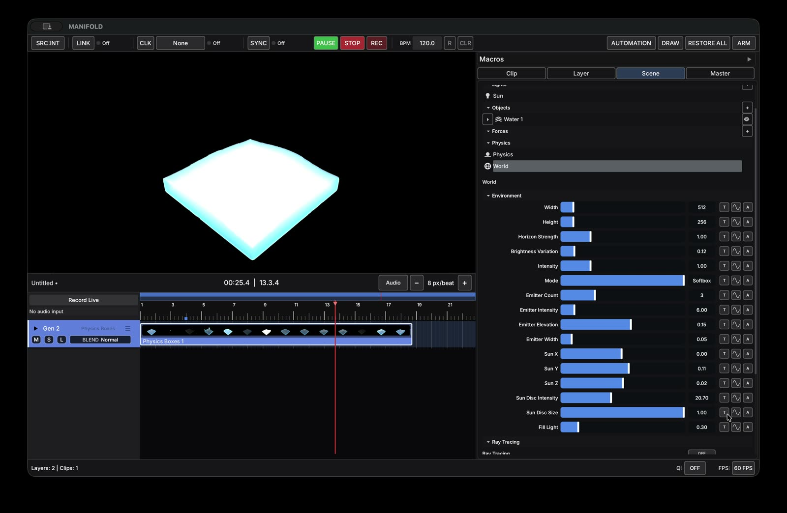

## Water

**2:35 to 2:52. Adding water, then a coat.** "let's add water okay so now we've got water what do we do… add coat what does that do… nope"
He removes every object and adds Water 1 from the Objects + menu. "+ Add Coat" adds a "Coat" drawer with Enabled On, Clearcoat Normal Scale, Clearcoat and Clearcoat Roughness. Nothing visible changes: the water is a small blob in the middle of the preview, with the camera Distance at 65.49 m.
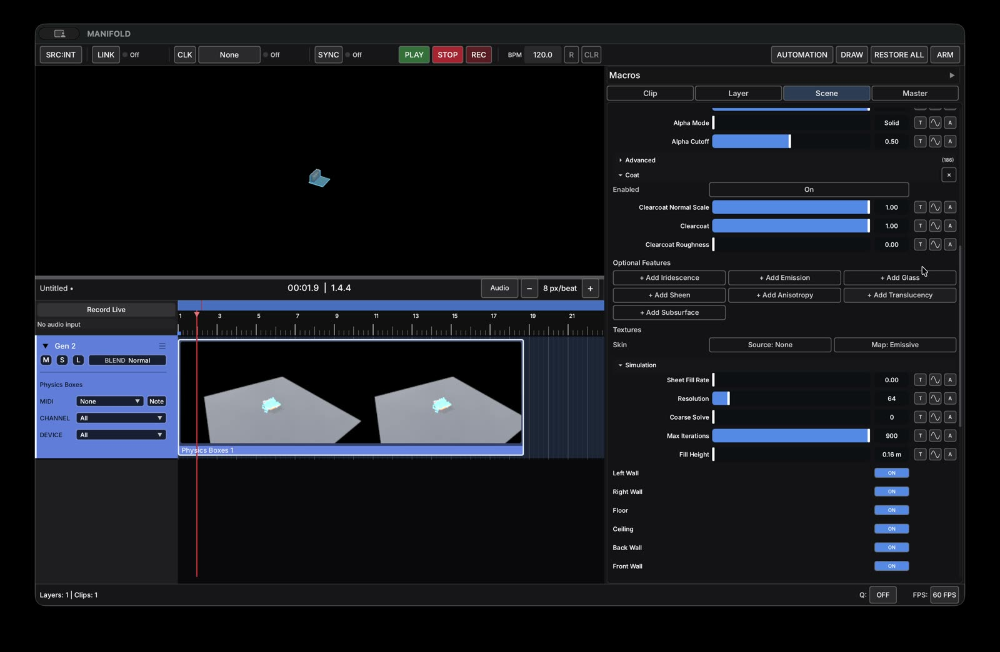

**2:52 to 3:01. Water settings.** "there's a lot of parameters here that just are kind of confusing like the [card] is pretty bad because it's been mostly thrown together lately"
Whisper heard "board". The brief reads it as "card", but at that moment the screen shows Water 1's settings in the Scene tab, so "water" fits too. On screen: Simulation (Sheet Fill Rate, Resolution 64, Coarse Solve 0, Max Iterations 900, Fill Height 0.16 m), six wall switches, Max Particles 0, Whitewater (a slider reading "On", Whitewater Amount, Wavecrest Emission 175, Turbulence Emission 175, Min/Max Turbulence 100/200), Dust Emission and Boundary Dust as small OFF pills, Dust Rate, Base Influence, Influence Decay, Spray Emission Speed, Emitter Generation. On/off settings use two different controls in the same list.
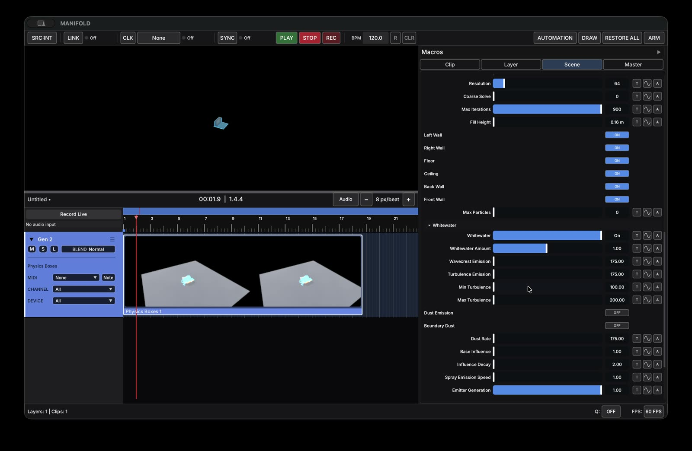

**3:01 to 3:09. Lattice readout.** "this is out of date as well the lattice thing is out of out of date doesn't seem to be correct"
Under "+ Add Modifier" a line reads "Lattice 64 × 64 × 64 · 6.2 cm cells · 262144 cells". He points the cursor at it.
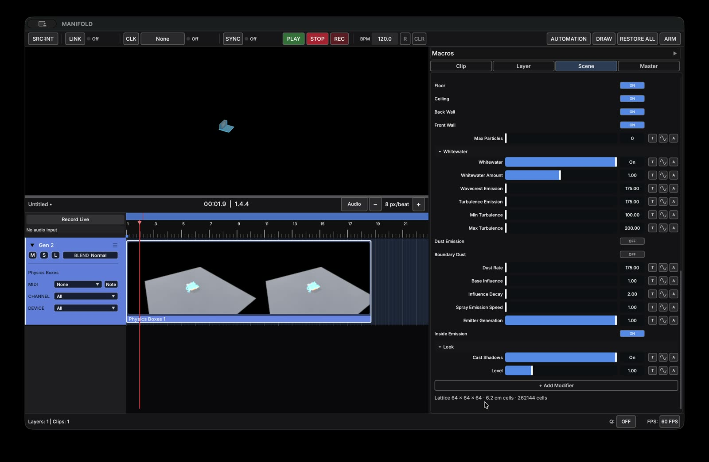

## Audio setup

**8:27 to 8:47. A new source starts on the system input.** "i want to add a source… now i have to change to like [None (layers only)] if i don't use the system audio so it should probably default to just the layers and then unless you pick system audio"
Audio Setup opens as a middle pane that squeezes the preview and timeline into the left third. A new source starts on Device "System Default". The device list puts "None (layers only)" first, then System Default, five input devices, and a "Capture Output" group with System Audio and more than 20 idle processes (com.apple helpers, loginwindow, Terminal and so on). Whisper's "none layers" is that "None (layers only)" item.
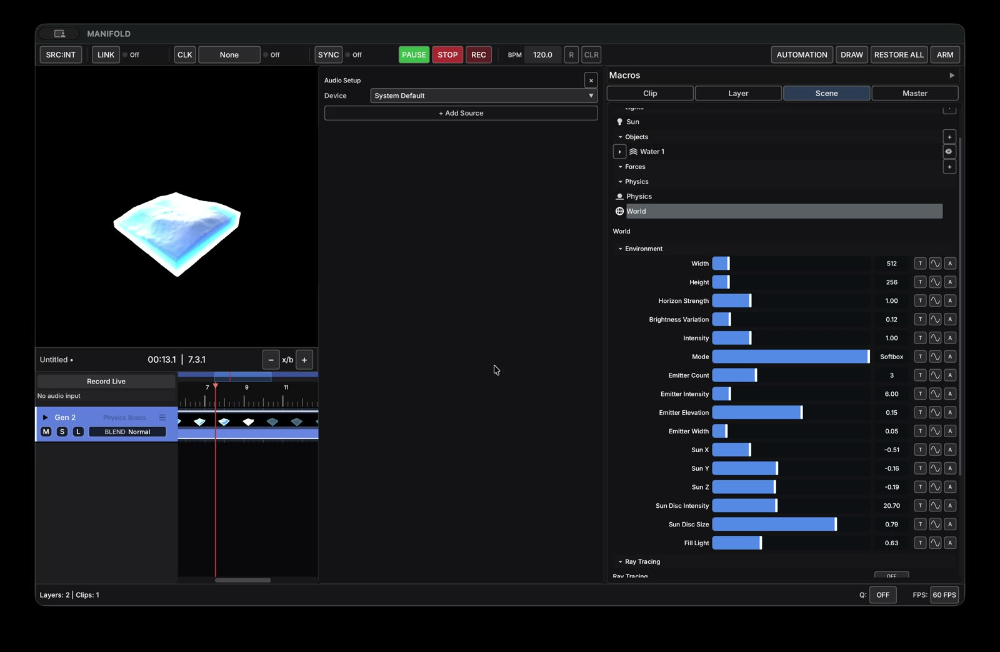
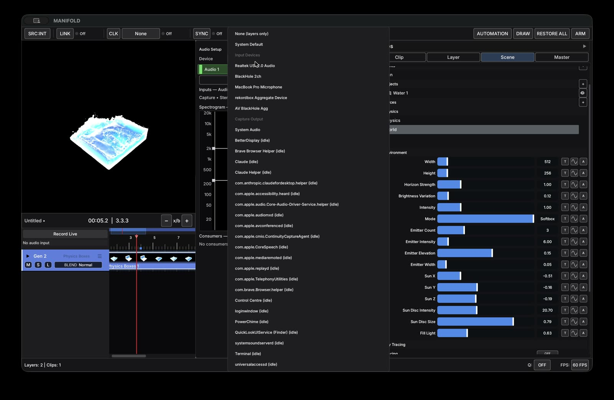

**8:47 to 9:10. A new audio layer needs manual routing.** "if i add an audio layer i have to then route this… i have to manually manually manually configure all this stuff and there's like obvious just defaults to be used"
The new Audio 3 layer arrives with "No source"; its dropdown offers "No source" and "Audio 1". Later Audio Setup lists "Layer • Audio 3" under "Inputs — Audio 1" while the layer's own dropdown still reads "No source", "Consumers — Audio 1" says "No consumers yet", and the timeline header still says "No audio input".
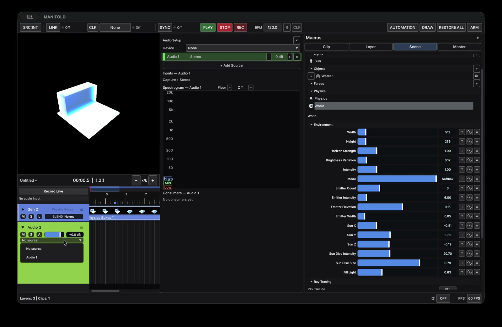
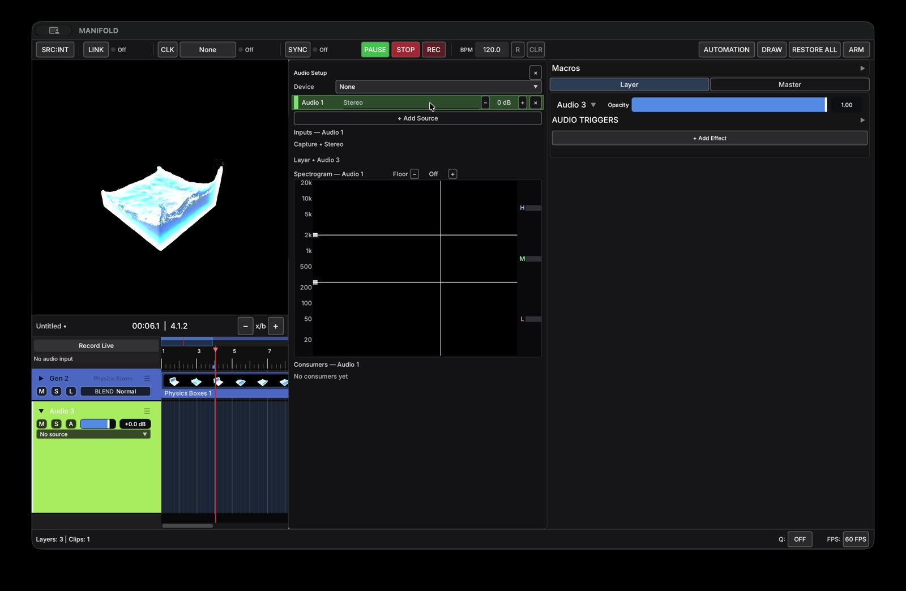

## Automation and trigger lanes

**3:57 to 4:11. "Add trigger lane" only on the parent layer.** "insert trigger lane… now i don't have the option here… if i right click a trigger lane i have to click the main one which is pretty annoying"
Right-clicking the Gen 2 header offers "Add trigger lane". Right-clicking Trigger 1 offers Paste, four Insert … Layer items, Duplicate Layer, Group Selected Layers and Delete Layer, but no "Add trigger lane". The inspector for Trigger 1 shows an Opacity slider, AUDIO TRIGGERS and "+ Add Effect" under Layer / Group / Master tabs.
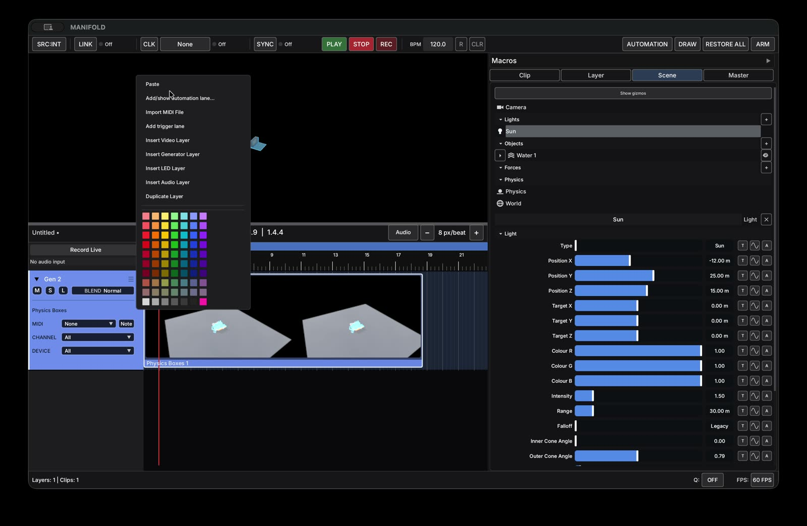
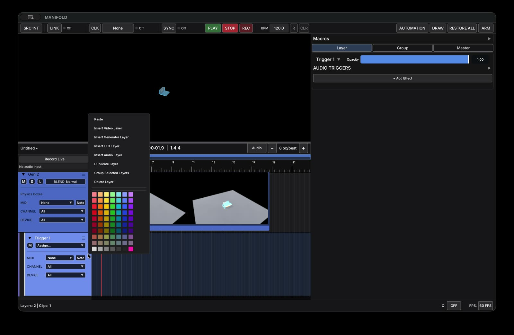

**4:11 to 4:30. Collapsing the layer hides its trigger lanes.** "i can't have a small top layer thing if i want to work on the trigger lanes which is maybe actually sensible"
Collapsing Gen 2 hides Trigger 1 entirely, while the inspector still shows Trigger 1 as selected. He half-accepts this.
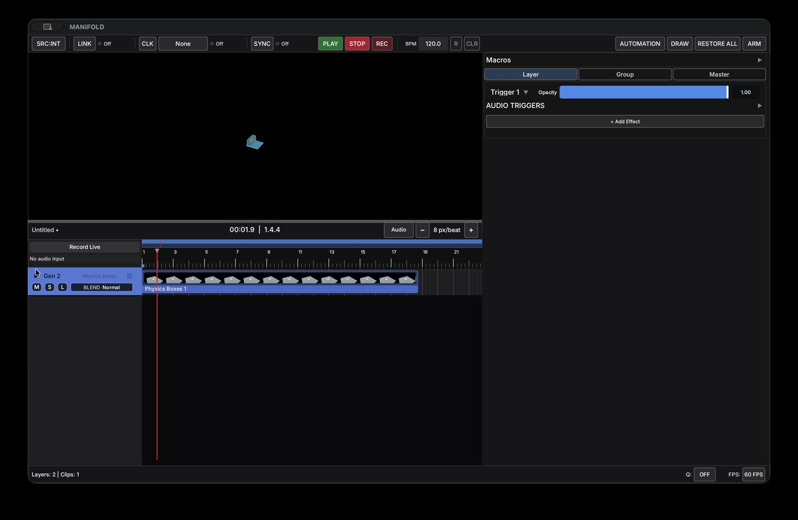

**9:52 to 10:01. DRAW and RESTORE ALL.** "what is this draw button doing restore all um this is a little confusing here but it's not super important"
The top bar has AUTOMATION, DRAW, RESTORE ALL and ARM. With AUTOMATION on, a lane "camera — Camera Orbit" with 360° / -360° appears under the clip and the Orbit row on the card is outlined. The cursor is on DRAW. Nothing on screen says what DRAW or RESTORE ALL do.
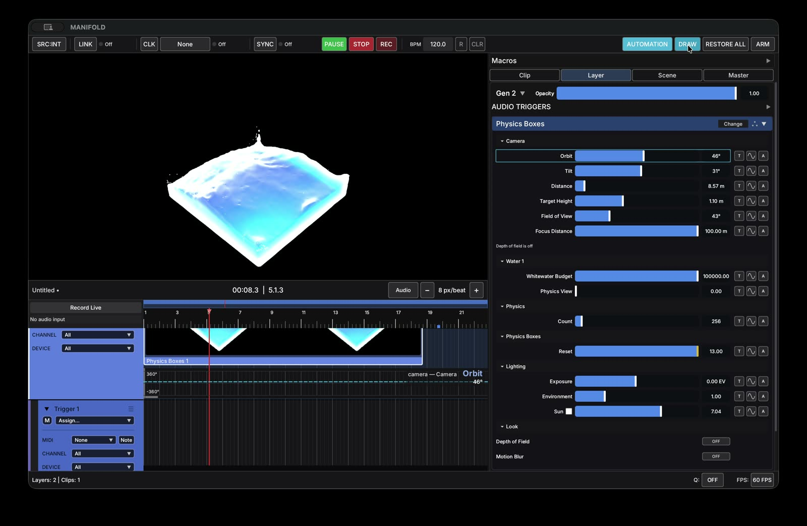

**10:02 to 10:26. No way to fold all the drawers.** "there used to be like a little cog or something that let you hide the drawers… collapse like all the drawers or something to reduce the clutter"
Orbit's LFO drawer is open on the card and pushes everything below it down by four rows; Count had one open a few seconds earlier. The card header has Change, a dots icon and ▼. Nothing there folds every drawer at once.
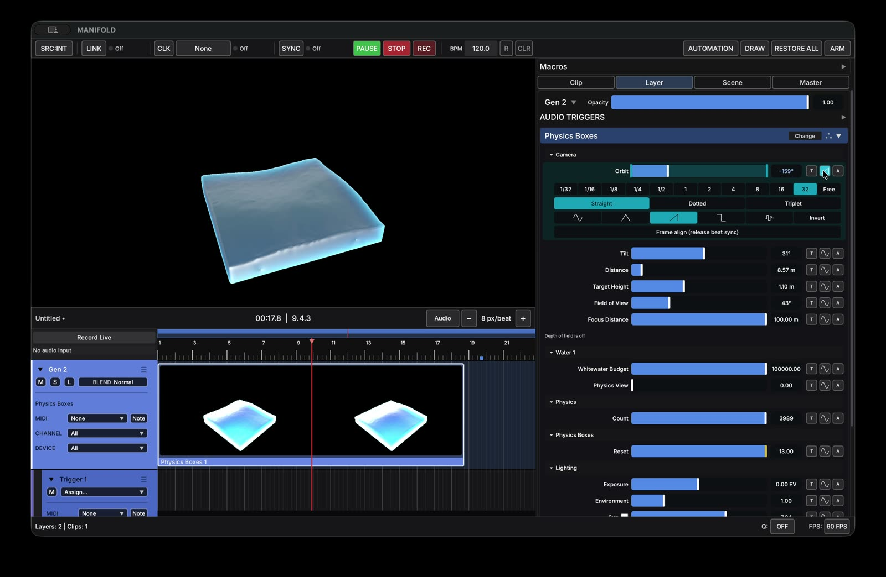

## Graph editor

**4:39 to 5:22. Scroll and node size.** "the scroll in the graph editor is horrible also like all the 3d scenes always have these like mega gigantic crazy huge nodes… it looks to work but not with the scroll wheel so something's broken it's very broken actually"
No frames. From 4:43 the main window's title is greyed, so another window had focus, and the graph editor window is not in the recording. Only his words back these.

## Inspector and general

**0:31 to 0:36. Missing thumbnails.** "a lot of the thumbnails are missing for some reason they're on black but it's not too big of a deal"
In the generator browser, Blossom Wire, Lantern, Lightning, Lissajous, Oscilloscope, Star Field, Tesseract and Wireframe are black or nearly black, and Fluid Simulation 3D, Ocean, Ocean Cliff and "Water — Sea Wall (GPU FLIP)" are flat grey.

**9:22 to 9:42. Inspector feels inconsistent; the clip tab is empty.** "the inspector kind of feels a bit awkward and inconsistent… i can click on the clip but there's nothing"
Clicking the clip opens the Clip tab, which shows only the word "Effects" and a line. No clip name, length or add button. The tab set also changes with the selection: Clip / Layer / Scene / Master for the generator layer, Layer / Group / Master for a trigger lane (4:03 frame), Layer / Master for an audio layer (9:00 frame).
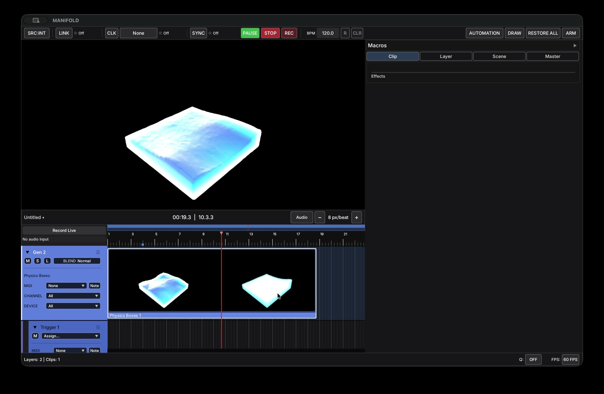

**3:09. Tooltips.** "some things have tooltips some things don't like i've seen them show up before"
No tooltip appears anywhere in the recording.

**3:27 to 3:34 and 10:33 to 10:53. Overall.** "it just feels like sloppy it doesn't feel like professional ui it's about 50 of the way there… cluttered and clunky… puzzled together and slopped together and not fully built with a strong design goal and strong user-facing interaction goal"
No single frame; the patterns below are the concrete version.

## What he liked

- Insert generator is quick (0:14): right-click, Insert Generator Layer, and a Plasma layer is on the timeline within about five seconds.
- Timeline scroll works well now, and clips look nice (0:21 to 0:31).
- Right-click menus are "pretty good" (3:49). See the layer menu frame above.
- The graph editor's mapping panel is "quite nice" (5:22). Not in the recording.
- The AUTOMATION button is "kind of cool" (9:46).
- The water look: "the little water actually looks pretty nice" (6:34), "wow that actually looks beautiful" (8:20), "a beautifully glowing" (9:14). See the 7:05 frame.

## Patterns across the frames

**Raw engine settings with no help.** Long lists of sliders named after the engine, with no default marked, no hint and often no unit, and values or labels cut off. Shows in: Glass (1:34), water settings (2:52), lattice readout (3:01), Sun and shadows (6:39), World > Environment and emitters (7:08, 7:41). Cut-off text in 0130, 0140 and 0652.

**The same setting in two or three places.** Sun intensity is the card's "Sun" and Lights > Sun > Intensity (5:49). Sun direction lives in Lights > Sun and again in World as Sun X/Y/Z (7:41). Camera framing is on the card and on the Camera node, and Exposure is on the card and under Lens (6:16). Box count is in the Boxes object, the Scene Physics node and the card (1:49). Glass is a material preset and an optional feature (1:23).

**Headings, links and buttons look alike.** Tree group headings and tree items share one look and one hover (3:34). A card drawer heading turns out to be a link to the Scene tab (10:26). Material preset buttons and "+ Add" feature buttons are the same button (1:23). Adding, enabling and removing a feature are three separate controls (1:28, 1:34).

**Choices and switches drawn as sliders.** Type "Sun", Falloff, Mode Softbox/Gradient, Alpha Mode "Solid", Whitewater "On", Cast Shadows "On", Shape "Cube", Body Type, Arrangement "Pile" are all sliders, next to real on/off pills for walls, dust and depth of field. Shows in: 1:23, 1:49, 2:52, 6:39, 7:08.

**Settings shown when they do nothing.** Focus Distance next to "Depth of field is off" (0:47), depth-of-field settings above their own off switch (6:16), cone angles and falloff on a sun (6:39), box count and spacing in a scene with no boxes (1:49).

**Leftover names.** After every box is gone the card, clip and generator are still "Physics Boxes" with box Count and Reset (5:41, 9:56, 10:25). The lattice readout he calls out of date (3:01).

**Useful features nobody can find.** Slider range behind a right-click (5:22), the card-to-Scene-tab link (10:26), hex entry behind a palette menu item (3:09). He says some form of "I didn't know this existed" at 5:45, 6:51 and 10:32.

**Setup that should have defaults.** A new audio source starts on the system input instead of "None (layers only)", and a new audio layer starts with "No source" (8:27, 8:47).

**One scroll for tree and settings.** The Scene tab's tree scrolls away as soon as he edits an object, so he keeps scrolling back up to switch objects (1:03 to 3:45).
